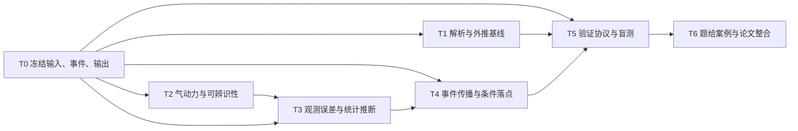

# UPC 2026 B 题｜点球落点预测的解题方案与代理任务书

这一版在英文初稿与上一轮规划基础上加入获奖论文参考、实证气动模型、分工批次、图表清单和跨代理验收。后续由参赛队按验证结果选择主模型。本轮完成文献和方案审查。

## 1. 把题目转化为预测问题

已知球心在 $t=0$ 时位于 $(0,0,0.11)\,\mathrm m$，并在 0.05 s 和 0.10 s 取得两组三维坐标。定义 $D$ 为这两次观测，$C$ 为球在首次触地前正向穿过 $x=11$ 平面，$G$ 为该次过线的球心落在题设门框矩形内。令 $T,Y,Z$ 分别为过线时刻、横向坐标和高度。交付四项结果。

| 结果 | 要回答的问题 | 报告口径 |
|---|---|---|
| $P(C\mid D)$ | 球在触地前能否到达球门平面 | 所有预测轨迹作分母 |
| $P(G\mid D)$ | 球有多大概率直接穿过门框 | 所有预测轨迹作分母，并另给 $P(G\mid C,D)$ |
| 门内 $(Y,Z)$ 的二维众数 | 若球进入门框，最可能从哪里进入 | 对门内预测分布取二维众数，同时报告平滑尺度和稳定性 |
| $(T,Y,Z)$ 的预测区间与联合区域 | 会在何时抵达，落点可能散布在哪里 | 标清以过线 $C$ 还是以入门 $G$ 为条件，剩余时间为 $T-0.10\,\mathrm s$ |

主判据采用题面的球心矩形。补充判据把两侧门柱与横梁向内缩一个球半径，估计几何净空。两者的差值可说明边界效应。触地优先、门柱和横梁边界以及并发事件要在计算前统一约定。触地后可能反弹入门的球归入“先触地”类。对无可用过线或入门样本的个案，保留事件概率及其抽样诊断，相关条件坐标记为不可估计。

代理之间统一交换三类记录。**输入**含试射编号、两帧时刻、两帧坐标和误差情景。**单条预测**含模型版本、事件类别、样本权重、过线时刻与坐标，未过线时坐标留空。**汇总**含概率、条件区间、各类别样本量和失败原因。验证真值单独保存，预测代理只读取输入。

## 2. 中文解题主线

**先做三条外推基线。** 第一条固定重力，只拟合初速度。第二条让每个坐标的加速度恒定，恰好插值三点。现有初稿的二次基准在约 0.405 s 过线，落点约为 $(2.49,1.92)\,\mathrm m$。它能展示误差放大。以 $s=t/(0.05\,\mathrm s)$ 表示时间，两个观测点在二次外推中的权重为 $s(2-s)$ 和 $s(s-1)/2$。在该基线过线时约为 $-49$ 与 $+29$。第三条可直接用 $x$ 外推 $y(x),z(x)$，作为几何对照。它固定预测目标在 11 m，但需要单独的速度模型才能给出抵达时刻，且只适用于 $x$ 单调增加的段。三条基线均沿用同一触地和过线定义。

令 $p=dy/dx$，则 $d^2y/dx^2=(a_y-p a_x)/v_x^2$。静风且阻力与速度共线时，阻力项在这个表达式中抵消。无横向气动力时，$y(x)$ 为直线，$d^2z/dx^2=-g/v_x^2$。因此可以用横向直线和竖向重力曲率作低参数对照。给定同一物理模型，核对时间域与 $x$ 域的过线结果。比较两种方法时，也要传播观测的 $x$ 坐标误差。

**用物理约束外推早期曲率。** 主候选模型包含重力、与相对空气速度反向的二次阻力、与相对速度垂直的有效横向气动力。先采用静风和常气动系数，拟合三分量初速度、一个阻力系数和两个有效横向系数。后续用“重力＋阻力”模型做消融，检验引入横向力是否改善未见数据的预测。两帧有六个坐标，即使六参数模型拟合良好，也要通过按参数尺度归一的观测雅可比、参数相关性和先验敏感性判断可辨识程度。论文解释有效气动力，真实转速、旋转轴和风速留作未观测量或错配情景。

沿用初稿的参数化，令 $\mathbf u=\mathbf v-\mathbf w$ 为球相对空气的速度，$\mathbf b=(0,-C_z,C_y)$ 为有效横向系数向量，$C_D$ 为阻力系数。令 $\rho$ 为密度，$R$ 为球半径，$m$ 为球质量，则正向方程是

$$
\dot{\mathbf r}=\mathbf v,\qquad
\dot{\mathbf v}=-g\mathbf e_z+
\frac{\rho\pi R^2}{2m}\lVert\mathbf u\rVert
(-C_D\mathbf u+\mathbf b\times\mathbf u).
$$

若每坐标独立误差标准差为 $\sigma$，三点二阶差分的加速度噪声标准差是 $\sqrt{5}\sigma/(0.05\,\mathrm s)^2$。在 1 cm 情景下约为 $8.9\,\mathrm{m/s^2}$。可设计一对早期都与观测相容的轨迹，检查其后半段能否落在横梁两侧。即使常系数模型在无噪声时可识别，有噪声时仍需检查预测是否由先验主导。

**区分坐标舍入与测量误差。** 若题面小数来自厘米舍入，潜在测量值位于观测值 $q$ 对应的区间 $[q-0.005,q+0.005)\,\mathrm m$。若再假设舍入前有高斯测量误差，单坐标似然就是均值为模型坐标的高斯分布落入该区间的概率。现有初稿采用每坐标 1 cm 独立高斯误差，可保留为可复算参考情景。题面未提供传感器误差标定，因此按多档误差和不同气动先验报告结果。分开记录观测误差、气动参数不确定性、模型结构差异和数值抽样误差。模型结构的差异以情景范围展示，只有明确指定模型权重才合并为一个概率分布。

**将整条预测分布推进到事件面。** 从带物理先验的后验抽取参数，每个样本都积分至首次正向过线、先触地或未过线终止，先统计事件概率，再计算各条件下的区间和众数。对门内二维密度使用明确的门内约束、网格和带宽，改变带宽与随机种子检查众数漂移。近门柱和横梁时保留联合区域。若预测呈多峰，可用网格最高密度区域或分区概率补充椭圆。

**通过预先设定的测试选择复杂度。** 先用解析真值和步长收敛排除计算错误，再用匹配生成模型检验统计校准，最后在风、速度相关阻力、非定常横向力和门框边缘情景中检查泛化。验证集保留真实先触地、出界、门内和数值失败样本。各方法使用同一批试射。事件概率在全样本评分，坐标误差在可比子集评分，同时给出分母和失败数。若复杂模型对简单模型的增益很小，或题给结果主要由先验决定，正文应如实选择较简单模型或并列报告结果。

## 3. 获奖论文与实证研究带来的改动

从用户提供的 [UPC 历年档案](https://l-zer0coder.github.io/upc-archive/index.html#papers) 查找论文，以主办方原件核对。以下为 PDF 页序。

| 获奖论文 | 原文中可借鉴的设计 | 在本题中的改造 |
|---|---|---|
| 2022 B 金奖 Team 480，§4.1–4.2，第 5–8 页。[原文](https://www.uphysicsc.com/2022-GM-B-480.pdf) | 重力、二次阻力与马格努斯力的三维前向试射，分组扫描速度和自旋 | 把前向轨迹作为两帧似然的计算核。图上同时标出已观测位置和与之相容的多条后段轨迹 |
| 2022 B 金奖 Team 358，图 15，第 14 页。[原文](https://www.uphysicsc.com/2022-GM-B-358.pdf) | 在球门正面展示模拟的门将防守倾向 | 沿用球门平面布局，绘制球的过线预测密度和门内众数。图旁单列未过线与门框外概率 |
| 2022 B 金奖 Team 471，§6–7、§10，第 28–33 页。[原文](https://www.uphysicsc.com/2022-GM-B-471.pdf) | 变量扰动与旋转衰减的模型修正，另有预先选定的罚失案例回顾 | 将因素逐项加入错配测试，留出后半段轨迹作真值。保留进门、偏出、触地和失败个案。旋转衰减只在高保真情景中检验 |
| 2025 B 金奖 Team 311，§4–5，第 15 页。[原文](https://www.uphysicsc.com/2025-GM-B-311.pdf) | 用模拟落点检查快速近似，并讨论阻力、风和积分近似 | 建立简化模型与独立高精度积分参照，分开报告积分误差和错配模型误差 |

### 外部研究如何进入参数表

- **阻力随速度与球型而变。** Asai 与 Seo 的多球型风洞实验用于限定可选 $C_D(Re)$ 曲线及转捩区间。Hong 与 Asai 的风洞及踢球机器人实验用于设计球型与面板朝向的差异情景。报告须记录各曲线对应的球型、朝向、实验速度域和图表来源。题目未指定球型，因此把各曲线作为备选情景。[Asai 与 Seo，2013](https://doi.org/10.1186/2193-1801-2-171) · [Hong 与 Asai，2014](https://doi.org/10.1038/srep05068)
- **升力优先用有效参数，增加自旋作为外部情景。** Goff 等人由 29 条飞行轨迹整理随速度变化的阻力和升力曲线。Carré 等人结合试射与三维轨迹建模研究转球。可借鉴曲线量级和自旋方向，取值前核对速度、球型与旋转方向。原研究用全程或更多轨迹点得到的拟合误差只适用于其研究设计。[Goff 等，2017](https://doi.org/10.1088/1361-6404/aa6fcd) · [Carré 等，2002](https://doi.org/10.1046/j.1460-2687.2002.00109.x)
- **低转速尾流是单独的机制。** 低旋足球实验显示横向力可随时间变化。把它设成错配真值，给相位和幅度外部范围，检查后段扩散。强压力测试须明确标注所用幅值属于构造情景。[Mizota 等，2013](https://pmc.ncbi.nlm.nih.gov/articles/PMC3660809/)
- **校准分两层。** 从拟合模型自己的先验生成参数，再用模拟观测检查后验秩，检验的是反演算法。独立生成器的错配盲测检验预测，另外报告事件概率的 Brier 分数和条件落点的二维能量分数。[Talts 等，SBC](https://arxiv.org/abs/1804.06788) · [Gneiting 与 Raftery，评分规则](https://doi.org/10.1198/016214506000001437)
- **实测候选单列。** Bassek 等发布了含比赛事件和球坐标的德甲数据，可先核查 J03WMX 中的已知点球。按实际帧时间输入模型，检查触球对齐、过线附近高度缺失及预处理是否使用未来帧。合格轨迹少时只作为外部案例。若有平滑或未来帧泄漏，应披露并降低外部检验的证据权重。本方案尚未读取该次点球轨迹。[数据论文](https://pmc.ncbi.nlm.nih.gov/articles/PMC11787359/) · [德甲比赛记录](https://www.bundesliga.com/en/bundesliga/matchday/2022-2023/34/1-fc-koeln-vs-fc-bayern-muenchen/liveticker)

### 增加模型层次与入选条件

| ID | 拟合模型或验证机制 | 增加的复杂度与留用判据 |
|---|---|---|
| B0–B2 | 仅重力、三点恒加速度、$x$ 域对照 | 统一事件判定。无时间输出的 $x$ 域模型参与落点比较，抵达时间评分单列 |
| M1 | 重力＋常系数二次阻力 | 用它判断仅靠速度衰减能解释多少数据，作为较低维的气动基线 |
| M2 | M1＋两分量有效横向力 | 保留初稿的六参数形式。用尺度归一的灵敏度、后验相关和弱方向的落点传播检查可辨识性 |
| M3 | 文献约束的 $C_D(Re)$ 曲线族＋有效横向力 | $Re=\rho(2R)\|\mathbf u\|/\mu$，其中 $\mu$ 为动力黏度。比较球型曲线和常系数。在每个情景重拟合前两帧，再预测后段。先看预测速度轨迹是否接近各曲线的转捩区，再解释差异 |
| S1 | 高精度真值生成，分别加恒定风、球型及面板朝向、随速度变化的阻力 | 单项错配和组合错配分开。已校准的物理曲线与故意放大的压力测试分开编号 |
| S2 | 自旋相关升力与低旋非定常尾流 | 有旋真值采用自旋比 $R\|\boldsymbol\omega\times\hat{\mathbf u}\|/\|\mathbf u\|$ 和外部给定的升力曲线，升力方向沿 $\boldsymbol\omega\times\mathbf u$。可比较恒定自旋和给定衰减时间。低旋尾流另设有时间相关性的横向扰动。自旋轴、衰减率和尾流相位均由外部情景给定 |
| S3 | 观测与事件错配 | 测试舍入、各向异性坐标误差、共用标定偏差及时间抖动。净空判据作为附加比较。反弹和完整球体过线若纳入，单独定义接触与过线几何 |

物理代理优先在 M1–M3 中选主模型。先冻结最小可接受增益、校准容差和评分集合，再看盲测结果。若 M3 的结论依赖球型选择，给出球型情景范围。只有存在可辩护的外部球型权重，才汇总成跨球型概率。蒙特卡洛的权重退化可用有效样本量和尾权重诊断，必要时用另一种采样方法复核少数代表性个案。[Vehtari 等，重要性采样诊断](https://www.jmlr.org/papers/v25/19-556.html)

物理代理还需画出或导出题例沿程的 $Re$ 区间，判断 M3 增加的复杂度是否实际影响本题。若需在不同曲线之间公平比较，可给各曲线同一个早期参考速度，拟合早期阻力锚点，保留实测曲线给出的速度依赖形状。曲线超出实验速度范围时标记外推，禁止把压力测试的转捩速度写作该球型的实测参数。反演代理可将白化的观测雅可比按先验尺度归一，再将三列初速度的影响投影掉，比较剩余气动方向能造成多大的门面偏移。[Raue 等，可辨识性](https://doi.org/10.1093/bioinformatics/btp358) · [Kreutz 等，预测可辨识性](https://pmc.ncbi.nlm.nih.gov/articles/PMC3490710/)

## 4. 从总目标分解到最小交付

验证代理可以在 T0 冻结后先设计测试。实际评价必须等预测接口交付，再按预先冻结的测试协议运行。

| 编号 | 小任务与未来交付 | 验收标准 |
|---|---|---|
| T0.1 | 列输入字典与单位，固定 $r_0,t_1,t_2$、坐标轴、$D$ 的顺序 | 任一代理能用同一行数据还原题例 |
| T0.2 | 列出门内、过线出界、先触地、未过线与计算失败的处理 | 物理结果互斥。计算失败单列，保留分母。写清平面、球半径、容差和事件优先级 |
| T0.3 | 冻结统一结果表和术语 | 各列有单位，区分估计条件、可用样本数与缺失原因 |
| T1.1 | 推导仅重力初速度拟合与真空过线解 | 报出三轴公式、正向过线时间和触地检查 |
| T1.2 | 推导三点恒加速度模型和误差放大 | 能独立复核题给二次基准，区分固定时间误差与事件时间误差 |
| T1.3 | 设计 $x$ 域几何外推对照 | 明确其单调域、时间输出缺失和与时间域基线的比较条件 |
| T2.1 | 写力学方程、符号与参数表 | 重力方向、阻力耗能、横向力垂直条件和单位均可检查 |
| T2.2 | 设计参数可辨识性诊断与气动系数取值依据 | 指出弱约束方向，记录先验范围、依据及至少两组替代情景 |
| T2.3 | 排列模型阶梯，定义保留复杂项的证据门槛 | 同一测试集比较。模型复杂度靠预测指标和稳定性决定 |
| T2.4 | 为 M3 建立可追溯的实测 $C_D(Re)$ 曲线族 | 记录实验球型、朝向、速度域、来源图号、数字化与插值方式。题例沿程的 $Re$ 与曲线范围同图核对 |
| T3.1 | 写高斯参考、舍入区间和误差敏感性方案 | 明确误差是设定、估计还是实测。分别讨论坐标相关和时间误差 |
| T3.2 | 设计拟合、后验抽样和质量诊断 | 记录提议分布或采样策略、有效样本量、极端权重、种子复跑及失败回退 |
| T3.3 | 构造早期相容而后段分歧的轨迹对 | 两条轨迹在观测容差内，并解释各自的物理参数。若无法找到横梁两侧案例，报告可达到的落点差 |
| T4.1 | 定义数值积分和首次事件定位接口 | 能复核真空解析解，区分起始接触与真正触地，覆盖并发、掠边及无解情景 |
| T4.2 | 设计概率、众数、边际区间与联合区域计算 | 每个概率有明确分母。每个条件量有支持样本数。报告平滑和抽样敏感性 |
| T5.1 | 写真空抛体、一维二次阻力、事件边界和步长收敛测试矩阵 | 容差在测试前确定，时间误差用秒，位置误差用米。固定样本检查步长，再固定步长检查抽样 |
| T5.2 | 冻结匹配与错配试射设计，覆盖门中、贴边和落地情景 | 抽样种子与调参种子分开，保留困难个案和方法失败 |
| T5.3 | 定义全样本分类评分及条件坐标评分 | 分别记录到达与入门的 Brier 分数，再在真值过线组报告坐标误差、区间覆盖率和无法输出的比例。共享子集才作成对 RMSE，并附样本数及抽样区间 |
| T5.4 | 把单因素错配、组合错配和候选外部实测分开 | 模拟中风、球型、自旋和观测误差可逐项追溯。实测记录是否能核验起踢时间与过线高度 |
| T6.1 | 制作 F1–F6 与题例结果表的数据和图注 | 统一球门方向、坐标比例、条件、分母、运行版本与观测窗口标记 |
| T6.2 | 撰写英文稿、复算说明和披露 | 匿名英文、每页队号、摘要 ≤300 词、正文自足、文内引文对应，文末核对 AI 原样提示词与完整输出 |
| T6.3 | 独立复核、检查报告与图表引用 | 图表可再生，摘要与正文引用同一数据版本，记录复核人和待解决项 |

## 5. 代理分工与执行批次

本轮分发的是文献与设计审查。下面是进入实现时的角色和文件所有权。每批最多三个代理并行，主代理负责规范、审批模型选型和最终验收。同一角色完成交付后再开启依赖它的任务。

| 批次与代理 | 负责什么 | 独占写入的交付物 | 交接条件 |
|---|---|---|---|
| 批 0，主代理 `b_integrator` | 冻结定义、模型 ID、评分方案和共用样例 | `spec/`、最终发布清单 | 用题例和一个边界样例逐字段核对接口 |
| 批 1，`b_physics` | 受力、解析基线、数值积分和事件定位 | `physics/`、文献气动曲线及来源表、收敛检查 | 给 `b_inference` 同一个前向接口，给 `b_validation` 事件测试样例和可调容差 |
| 批 1，`b_inference` | 观测似然、先验、后验、可辨识性和预测分布 | `inference/`、题例预测、情景结果及抽样诊断 | 先用冻结的样例搭建接口，等前向模块交付后再输出正式题例 |
| 批 1–2，`b_validation` | 独立真值生成器、盲测、评分与失败审计 | `validation/`、数据划分、逐试射评分和表格数据 | 批 1 预登记并封存真值，批 2 接收预测后解封评分 |
| 批 2，`b_figures` | 图形样式、制图和图注 | `figures/`、出图脚本、F1–F6 及 `figures_manifest.csv` | 可用测试样例搭版。最终图只读取冻结版结果，记录裁剪、分母和来源 |
| 批 2，`b_paper` | 英文成稿、摘要、表格排版和文内引用 | `paper/`、`claims.csv`、AI 披露草稿 | 方法章可先写。结果段、图注引用和摘要等验证及图件冻结后补齐 |
| 批 3，`b_review` | 独立复算和全文对账 | `review/` 下的核查记录 | 同一发布版本重新生成主图和主表，审查每个数字、概率条件及引用。主代理按清单合并 |

### 进入实现后可转发的提示词

**共同前缀**

> 读取本任务书、题面和冻结的 `spec/`。在分配目录内工作。复用共同坐标、单位、模型 ID 和事件定义。向下游交付文件、输入版本、运行命令、检查结果和未解决项。发现口径冲突时把具体字段和样例交给主代理裁决。图表和正文使用同一个发布版本。

**`b_physics`｜T1、T2、T4.1**

> 实现 B0–B2 与 M1–M3 的统一前向接口。输入参数、两帧时刻与模型配置，输出两帧坐标、按需轨迹点和首次事件。为每条气动曲线记录球型、来源图表和速度适用域。用真空、一维阻力、过线与触地竞争事件及步长收敛交付测试结果。汇报哪类题例速度段可能穿越转捩区。

**`b_inference`｜T2.2、T3、T4.2**

> 按候选模型拟合相同两帧，交付白化雅可比的奇异值、弱方向落点、概率与条件区域。每个噪声或球型情景重新拟合，记录先验、似然、种子、有效样本量和失败原因。另构造一对前 0.10 s 都能解释观测、后段可能落在横梁两侧的轨迹。将题例与盲测输入分开，按统一字段提交逐样本和汇总结果。

**`b_validation`｜T5**

> 先冻结试射生成方案、预留数据和评分阈值。分别实现匹配生成、单因素错配和组合错配。物理真值使用独立的高精度积分设置。记录整批事件与数值失败。预测缺失若允许兜底，预先冻结兜底规则并单列发生率。输出到达与入门的 Brier 分数、可靠性图数据、50/80/95% 条件覆盖率、二维能量分数、成对 RMSE 及分母。若只评估真值过线组的有效条件分布，同时列出该组无法输出的比例。

**`b_figures`｜T6.1**

> 按 F1–F6 图单使用冻结数据出图。为每张图交付矢量 PDF、预览 PNG、生成脚本和英文图注。清单注明输入表、查询条件、分母、单位、发布版本及对应结论。热图注明条件和色标单位，轨迹图明示 0.10 s 观测截止。遇到未过线样本和极端坐标，按图单处理并披露画面范围。

**`b_paper`｜T6.2**

> 写一篇自足的英文匿名竞赛稿。用题目口径开篇，依次写基线、候选力学、两帧反演、模型比较与验证、题例结果、局限。摘要最后写。所有数字从同一发布版本的汇总字段提取，逐条在 `claims.csv` 绑定数据、分母、单位与图表编号。将条件众数、边际中位数与几何入门概率分别陈述。检查引用和 AI 使用披露。

**`b_review`｜独立复核**

> 对照冻结版本逐条核查摘要、正文、图和表。手算题例的二次基准，复查门框边界、触地优先与概率恒等式。抽查一个匹配试射和一个错配或失败试射，确认它们进入相应分母。检查原始来源是否支持每条经验参数，提交通过项和阻断项。

## 6. 制图清单与写作证据

| 图号 | `b_figures` 画什么 | 数据与图注要求 | `b_paper` 使用位置 |
|---|---|---|---|
| **F1 观测与外推** | 两联图 $y(x),z(x)$。三点观测、基线、主模型轨迹扇形与 $x=11$ m 标线 | 横纵轴均标 m。阴影标观测范围。用固定种子选代表样本，保留样本选择规则 | 基线与方法 |
| **F2 球门正面** | 过线点密度与 95% 联合区域，实线门框、虚线净空边界、门内众数和基线点。全框主图，可加边角放大 | $y,z$ 用 m，色标注明为条件密度或每网格概率。图注注明以过线为条件。门外落点与未过线概率在图旁列出 | 题例主结果 |
| **F3 模型可辨识性** | 白化观测雅可比奇异值，以及两条早期相容、后段分离的示例轨迹 | 无量纲奇异值与标为 m 的落点变化分开。案例标出各自假设和事件，保持两帧观测相同 | 模型选择与局限 |
| **F4 误差与气动情景** | 不同观测误差下的入门概率；不同球型、风与横向力情景下的落点区间 | 误差轴用 mm，概率用统一比例。明确模型及每格情景是否重拟合。有实证曲线才画 $C_D(Re)$ 小图，并标曲线适用区间 | 敏感性分析 |
| **F5 概率校准与失败** | 到达、入门的可靠性图，加模型及场景的失败计数或失败率 | 图示对角线、每箱试射数及抽样区间。匹配、单项错配、组合错配分别标注 | 验证 |
| **F6 条件落点与误差** | 50/80/95% 名义与实际覆盖对照，旁图显示模型间成对落点误差或能量分数 | 两者均写明只在真值过线组的何种子集计算，报告每模型可用率。距离误差与能量分数均以 m 表示 | 模型对比 |

正文优先 F1、F2、F4、F5；F3、F6 若支撑主结论则放正文，否则放附录。三张表统一由数据生成：**表 1** 假设、单位、数值和来源，**表 2** 题例条件结果与事件概率，**表 3** 验证各层的指标、分母和失败数。

## 7. 跨代理一致性与发布门槛

### 唯一规范与唯一结果源

| 文件或数据 | 最小字段与核对项 | 写入人 |
|---|---|---|
| `spec/case.json`、`spec/schema.md` | 题例两帧及原点、球半径、门框、单位、轴向、浮点边界容差、事件优先级与精确定义 | 主代理 |
| `spec/models.csv`、`spec/protocol.md` | 模型及误差情景 ID、参数、来源；训练和盲测隔离、固定评分和失败策略、选型阈值 | 主代理合并各角色草案 |
| `predictions.csv` | 键为 `case_id, model_id, scenario_id, draw_id`。字段包括 `weight, event, t_s, y_m, z_m` 和净空标记。未过线的交点留空 | 反演代理 |
| `cases.csv`、`truth.csv`、`metrics.csv` | 前者仅含早期观测和误差配置，真值表保管真值事件与交点，指标表含真值过线数、可评分数及失败数 | 验证代理 |
| `summary.json`、`release.json` | 概率、分母、条件区间、模式、样本量；记录 `run_id`、代码版本、配置摘要、种子、积分容差和输入数据哈希 | 主代理发布 |
| `figures_manifest.csv`、`claims.csv` | 每图与每条定量结论指向同一 `run_id` 及具体汇总字段或验证表行 | 制图与写作代理各自写入 |

坐标统一为踢球者朝球门的右手系，$+x$ 朝球门，$+z$ 向上，$+y$ 指向踢球者左侧。图中默认写“正 $y$ 侧”，避免球门正面视角造成方向反转。概率数据存 0–1，论文统一按百分数展示。若改球门朝向、球半径、事件边界、模型参数或采样种子，就更新发布版本，并重新生成受影响的图、表、摘要和结论。代码与中间数据保留全精度，仅在最终展示时按统一规则取舍。

### 交接与核验

1. **接口关。** 用统一样例跑通模型、评分、绘图的读写链。检查试射 ID、单位、过线方向、事件优先级和无效值处理。可先采用 1 mm、0.1 ms 作为步长复算的目标容差，在求解前冻结，近边界同时记录是否改判。
2. **盲测关。** 验证代理在收到预测后解封真值。核对全部测试个案、有效输出和失败数能对账，模型选型依据采用已冻结指标。
3. **结果关。** 在同一事件判据下检查入门样本是过线样本子集，净空入门是球心入门子集。若每条轨迹均成功分类，检查 $P(G)=P(C)P(G\mid C)$，并核对各互斥事件的权重和。数值失败单列，给出失败样本全部未入门与全部入门两种极端下的概率界限。图中裁掉的门外质量、展示时的分母与发布结果须一致。
4. **文稿关。** 审查 F1–F6、三张表、摘要和正文，逐项核对条件、单位、样本数及运行版本。若正文说模型改善预测，须能指到对应的盲测分层指标及不确定区间。

## 8. 合并与决策

1. **冻结接口。** 主代理合并 T0。代理发现同一事件有不同定义时，先确定主判据和敏感性判据，再推进其余设计。
2. **检查模型是否值得用。** 核对解析和积分，再比较不同方法在匹配与错配测试中的表现。现有初稿采用 1 cm 假设，并以预测过线样本数筛选部分验证个案。新方案分别用误差情景和完整验证分母检验这两处设计。是否保留完整气动模型由预先约定的校准、精度和失败率共同决定。
3. **合并题例和论文。** 用一张结果表区分条件落点、直接入门概率、抵达时间和情景敏感性。数值逐项关联到模型、配置与测试。可选扩展是独立视频数据、时间误差和坐标相关误差、弹跳与完整球体过线。主线完成后再决定是否纳入。

## 参考入口

- 题面与竞赛格式。[2026 年官方题目](https://university-physics-competition.com/2026-competition) · [官方规则](https://university-physics-competition.com/contest-rules)
- 2022 年金奖论文可参考三维受力建模和论证结构。本题额外要从两帧逆推，并评估预测校准。[UPC 2022 B，Team 480](https://www.uphysicsc.com/2022-GM-B-480.pdf)
- 球的阻力与升力实验可用于约束气动参数的量级。[Asai 与 Seo，阻力实验](https://doi.org/10.1186/2193-1801-2-171) · [Goff 与 Carré，升力反推](https://doi.org/10.1088/0143-0807/31/4/007)
